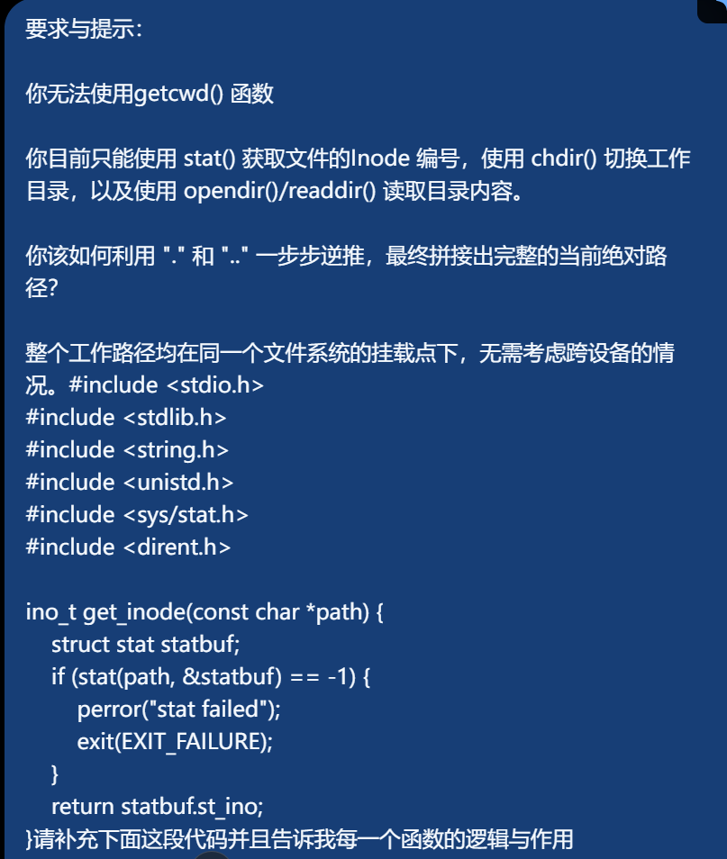
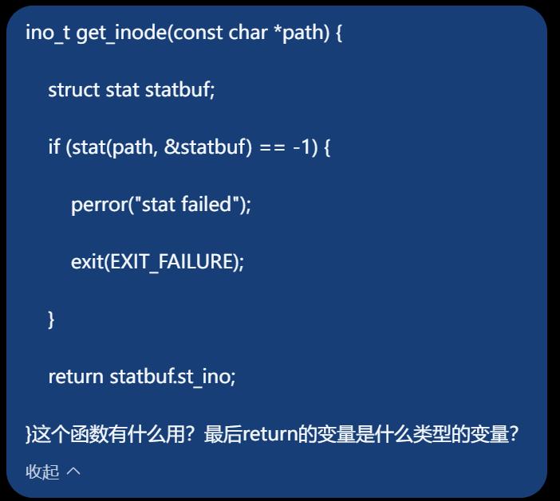

# MEDIUM-3：初识Linux系统
## 第一境：算者—— 命令行参数与路径
### 1.1
1. 
- 绝对路径是从根目录 / 开始描述文件位置的完整路径。因为它从 / 开始，所以无论当前所在目录是什么，都能准确找到你想找的文件。eg:`/home/user/document/test.txt`，假如当前在：`/home/user`，执行`cat /home/user/document/test.txt`仍然可以找到这个文件。

- 相对路径不是从 / 开始，而是以当前所在目录（当前工作目录）作为起点。eg:`./document/test.txt`，假如当前目录是：`/home/user`，而文件位于：`/home/user/document/test.txt`那么可以使用相对路径：`document/test.txt`或者`./document/test.txt`找到文件。*另外，..表示当前目录的上一级目录，假如当前目录：`/home/user/document`那么`..`就是`/home/user`因此`../test.txt`表示在当前目录的上一级目录中寻找 `test.txt`。*
2. 绝对路径命令：`cd /var/backups/turing/`; 相对路径命令：`cd ../../../var/backups/turing/ `

### 1.2
1. 
- `argc（argument count）`：表示命令行参数的个数。
- `argv（argument vector）`：是一个字符串数组，每个元素保存一个命令行参数。
- eg:
   - argv[0]：通常是程序名。
   - argv[1]：第一个参数。
   - argv[2]：第二个参数，以此类推。
2. 对于`cd ../../../var/backups/turing/ `而言，argc的值是2，argv[0]、argv[1]、argv[2] 分别指向`cd` `../../../var/backups/turing/`和 `NULL`

## 第二境：算王—— 重建 ls 命令与位运算
### 2.1
1. 
- 下面这四个头文件是我见过的：<stdio.h>：标准输入输出，例如 printf()、perror()。<stdlib.h>：标准库，例如 exit()、EXIT_FAILURE、malloc()、calloc()、realloc()、free()等动态内存管理函数。<string.h>：字符串处理函数，例如 strlen()、strcpy() 等。<time.h>：时间和日期处理，例如 strftime()、localtime()。
- 下面几个是不常见的：<dirent.h>：用于读取目录内容，例如遍历目录中的文件。<sys/stat.h>：用于获取文件的属性和元数据，例如文件大小、权限、修改时间等。<sys/types.h>：提供一些 POSIX/Linux 中常用的数据类型，例如 mode_t。在很多程序中会间接包含，因此平时可能不需要自己显式写出来。
2. 
- <dirent.h>提供了
   - opendir()；打开目录。
   - readdir():一个一个读取目录项。
   - closedir()：关闭已经打开的目录，释放相关资源。
   - DIR：<dirent.h> 提供的目录类型。DIR *dir用来记录已经打开的目录中的信息。
   - struct dirent *entry：struct dirent 表示目录中的一个目录项，其中包含文件名等信息。
- <sys/stat.h>提供了 
   - stat() 负责“获取文件信息”.根据文件路径获取文件的详细属性，并把结果写入 struct stat。
   - mode_t 负责表示“文件类型和权限等模式信息”。
   - struct stat <sys/stat.h>提供的文件属性结构体，用于保存文件的各种信息。例如:statbuf.st_size 保存文件大小。statbuf.st_mode 保存文件类型、权限等。statbuf.st_mtime 保存最后修改时间。

### 2.2
1. Linux 中把权限表示成一组 bit（位）。对于一个文件来说，权限主要分成三组：用户（ r w x ）,用户组（ r w x ）, 其他用户( r w x )。
每一个权限都可以用 1 个 bit 表示。其中`r = 1->有读权限;w = 1->有写权限;x = 1->有执行权限;没有权限则为 0`。例如：`rwxr-xr-x`可以表示成：`rwx  r-x  r-x 111  101  101`也就是：`111101101`。所以，一个整数的二进制位就可以同时保存这些权限信息。

2. 
```c
// mode即传入的存储权限信息的整数， 如0754（八进制表示）
// 提示：传入的 mode 变量不仅包含权限信息，高位可能还包含文件类型。在进行位运算时，请注意屏蔽（Mask）掉不需要的高位数据。
void parse_permissions(mode_t mode, char *perms) {

    // 权限字符对照表
    char rwx[] = {'r', 'w', 'x'};

    // 请补全代码写在 TO DO 与 END OF TO DO 之间：
    // TO DO
   int Mask=0777;
   int result=mode&Mask;
   for(int i=0;i<9;i++)
   {
      int a=1<<i;
      if(!result & (1 << (8 - i)))
      {
         perms[i]='-';
      }
      else
      {
         perms[i] = rwx[i % 3];
      }
   }   
   // END OF TO DO

    perms[9] = '\0'; // 字符串结尾
}
```   

## 第三境：算尊—— 深入理解 Inode 与文件树
### 3.1
1. Inode 中存储了文件的哪些信息？**Inode（索引节点）主要存储文件的元数据，** 例如：
   - 文件类型：普通文件、目录、符号链接等
   - 文件权限：读、写、执行权限
   - 文件所有者的 UID
   - 文件所属组的 GID
   - 文件大小
   - 时间信息：访问时间、修改时间、状态改变时间等
   - 硬链接数量
   - 文件数据块的位置（用于找到文件实际存储的数据）
2. Inode 中不包含文件的什么信息？Inode 不存储文件名。
   - 文件名实际上存储在目录的数据中。目录中的目录项会建立：文件名 → Inode 编号的对应关系。
   - 这也是为什么修改文件名通常不会改变文件的 Inode 编号。
3. "." 和 ".."它们分别代表什么？它们的 Inode 编号在系统根目录"/"下有什么特殊规律？
   - .	代表当前目录本身
   - ..	代表当前目录的父目录
   - eg:
```c
/home/user/
//在 user 目录中：
.   → /home/user
..  → /home
cd .
//相当于留在当前目录；
cd ..
//则进入父目录。
```
   - 在系统根目录中，因为根目录没有父目录，所以.与..都代表系统根目录本身。即在根目录下，. 和 .. 的 Inode 编号相同，并且都等于根目录 / 的 Inode 编号。      

### 3.2
```c
#include <stdio.h>
#include <stdlib.h>
#include <string.h>
#include <unistd.h>
#include <sys/stat.h>
#include <dirent.h>

ino_t get_inode(const char *path) {
    struct stat statbuf;
    if (stat(path, &statbuf) == -1) {
        perror("stat failed");
        exit(EXIT_FAILURE);
    }
    return statbuf.st_ino;
}

char  *find_name(ino_t current_inode)
{
    DIR *dir;
    struct dirent *entry;
    dir=opendir("..");
    if(dir==NULL)
    {
      perror("opendir failed");
      exit(EXIT_FAILURE);
    }
    
    entry=readdir(dir);
    while(entry!=NULL)
    {
      if(entry->d_ino==current_inode)
      {
         char *name=malloc(strlen(entry->d_name)+1);
         if(name==NULL)
         {
            perror("malloc failed");
            closedir(dir);
            exit(EXIT_FAILURE);

         }
         strcpy(name,entry->d_name);
         closedir(dir);
         return name;
      }
    }
    closedir(dir);
    return NULL;

}

int main(void)
{
   char **names=NULL;
   int count=0;
   while(1)
   {
      ino_t current_inode=get_inode(".");
      ino_t parent_inode = get_inode("..");
      if(current_inode==parent_inode)
      {
         break;
      }
      char *name=find_name(current_inode);
      
      if(name==NULL)
      {
         fprintf(stderr, "cannot find directory name\n");
         exit(EXIT_FAILURE);
      }
      names[count]=name;
      count++;
      
      if(chdir("..")==-1)
      {
         perror("chdir failed");
         exit(EXIT_FAILURE);
      }
   
   }
   printf("/");
   for (int i = count - 1; i >= 0; i--) 
   {

        printf("%s", names[i]);

        if (i != 0)
            printf("/");

        free(names[i]);
    }

    printf("\n");

    free(names);

    return 0;
}
```
>这道题我一开始确实不太会，所以借助了ai的力量，ai给我生成的代码我放在了mypwd.c文件中，上面这段代码是我看完看懂ai写的代码后自己重新写的。我的主要提示词如下：





>下面我简单介绍一下我实现每一个函数的思路
1. char  *find_name(ino_t current_inode)
- 首先要明确这个函数的作用：得到当前目录的名字。那么因为名字是字符串，所以需要定义一个结构体指针` struct dirent *entry`，同时因为要打开父目录，所以肯定需要一个`DIR *dir`来保存信息。
- 用`dir`保存`opendir".."`的信息之后，要先判断dir是否为NULL，即opendir是否成功，若失败则exit。判断完之后再进行下一步--用`entry`保存`readdir(dir)`。这里同样要分两种情况，如果`entry`为`NULL`，就直接`closedir`并返回`NULL`，成功才进行下一步。
- 接下来是最重要的一个循环--while循环。在这个循环中，我们要一直在父目录的所有子目录中检索与`current_inode`相同的inode并得到它的名字（即完成inode->名字字符串的转换过程）。找到与`current_inode`对应的目录名后就`malloc`一块内存，定义一个`name`指针给它保存起来（注意这里`malloc`的内存大小是`strlen entry->d_name+1`因为字符数组最后有'\0'），当然这里依旧要讨论`malloc`是否成功，若成功，才把`d_name`里的字符`strcpy`到`name`中。最后`close(dir)`并返回`name`。

2. 主函数
- 首先为了计数方便，要先定义一个`count`并初始化为0，再定义一个二级指针`names`用来保存各个一级指针`name`，然后就是进入循环来不断获取当前目录的名字并一步步向上推直到回到根目录。
- 循环中，先要定义`current_inode`和`parent_inode`。当两者相等时，证明已到根目录，此时可以break；当两者不相等时，先调用一次find_name并用`name`保存（当然要判断`name`是否为NULL）,然后就是把`name`存入`names`中便于打印，再进行count++，让循环不断向上寻找直到根目录。最后就是如果无法用`chdir`切换到父目录就`exit`。
- 最后就是倒序打印。首先要打印一个`'\'`表示根目录，然后就是利用count进行倒序打印。当打印的当前目录名字不是最终目录时要在目录之间打印`\`，打印完之后要记得`free`掉`names`和`name`。这样就实现了全部功能。

## 最终境：算帝—— 递归与文件筛选
### 4.1
```c
#include <stdio.h>
#include <string.h>
#include <dirent.h>
#include <sys/stat.h>
#include <unistd.h>

// 递归查找指定文件，若找到则打印其相对路径
void find_file(const char *current_path, const char *target_name) {
    DIR *dir;
    struct dirent *entry;
    struct stat statbuf;

    if (!(dir = opendir(current_path))) {
        return; // 无法打开目录则跳过
    }

    while ((entry = readdir(dir)) != NULL) {
        // 忽略当前目录 . 和父目录 .. 防止无限死循环
        if (strcmp(entry->d_name, ".") == 0 || strcmp(entry->d_name, "..") == 0) {
            continue;
        }

        char full_path[1024];
        snprintf(full_path, sizeof(full_path), "%s/%s", current_path, entry->d_name);

        if (stat(full_path, &statbuf) == -1) continue;

        // 请补全代码写在 TO DO 与 END OF TO DO 之间：
        // 要求：
        // 1. 检查当前 entry 的文件名是否与 target_name 匹配，若匹配则打印 full_path。
        // 2. 如果当前 entry 是一个目录，则需要对其进行深度优先的递归查找。
        // （提示：若(statbuf.st_mode & S_IFMT) == S_IFDIR则statbuf为目录文件）
        // TO DO
         if(strcmp(entry->d_name,target_name)==0)
         {
            printf("%s\n",full_path);
            return;
         }

         if((statbuf.st_mode & S_IFMT) == S_IFDIR)
         {
            find_file(full_path,target_name);
         }

           // END OF TO DO
    }
    closedir(dir);
}
```